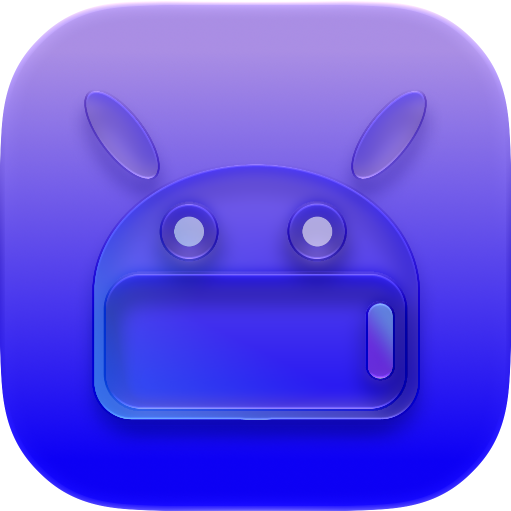

<p align="center">
  
</p>

<h1 align="center">Husk</h1>

<p align="center">Virtual Android machines on your iPhone.</p>

<p align="center">
  <a href="https://itslevii.dev/docs/install">Install</a>
  ·
  <a href="https://itslevii.dev">Website</a>
  ·
  <a href="https://github.com/Leviidev/Husk/releases">Releases</a>
</p>

<p align="center">
  <a href="https://github.com/Leviidev/Husk/releases"></a>
  <a href="LICENSE"></a>
</p>

Husk boots real ARM64 Android guests under QEMU, inside the app's own process. It keeps a list of machines instead of a single shared guest: each one has its own Android version, data disk, UEFI variables, screen shape, RAM and saved state.

- **Built-in image** — Android 13 (LineageOS 20), downloaded from the Husk release and bootable on its own.
- **Older Android** — Android 4.4 through 14 are in the version picker. Import a QEMU-ready `.qcow2` or `.img` system disk for the version you want; Husk supplies that machine's userdata and UEFI variables.
- **One at a time** — iOS allows one in-process VM, so only one machine runs at a time. Starting another opens the running one.
- **Separate data** — apps, accounts and files stay in the machine's own data disk. Duplicating a machine copies it, data included; resetting one keeps its system image.
- **Saved state** — a booted machine can be snapshotted, so the next start restores in seconds instead of cold-booting. A fresh machine cold-boots once and then saves its own snapshot.

## Install

Sideload with SideStore, AltStore, or TrollStore. iOS 15.5 or later.

**Guide:** [itslevii.dev/docs/install](https://itslevii.dev/docs/install)

Add this source in SideStore or AltStore (Sources › +):

```
https://itslevii.dev/repo.json
```

Or download `Husk.ipa` from [Releases](https://github.com/Leviidev/Husk/releases).

Android needs [JIT](https://itslevii.dev/docs/jit). Without executable memory QEMU cannot start, so the app refuses to boot a machine rather than crash.

## Images

The built-in LineageOS image is the one Husk ships a download for, and the only one whose boot path is tested. The other versions are a catalogue of machines Husk knows how to build, not a promise that a compatible image is hosted here. Your imported disk must be a bootable EFI Android system disk for the same QEMU `virt` machine; a random phone image or a partition dump will not boot. See [docs/07-virtual-machines.md](docs/07-virtual-machines.md) for what the manager stores and what an image has to provide.

## Building

On a Mac with Xcode, plus `meson`, `ninja`, `pkg-config`, `python3`, `xcodegen`, `qemu-img`, and a Rust toolchain with `aarch64-apple-ios`:

```sh
./scripts/ci_build.sh
```

That produces `build/Husk.ipa`. Later app-only rebuilds: `./scripts/package_ipa.sh` → `~/Desktop/Husk.ipa`.

The same full build runs in GitHub Actions on `macos-26` (`.github/workflows/build.yml`): it installs `meson`, `qemu` and `xcodegen`, adds the `aarch64-apple-ios` Rust target, runs `ci_build.sh`, and uploads the signed-for-sideloading `.ipa`/`.tipa` as build artifacts. It is triggered manually from the Actions tab (to avoid burning macOS minutes on every push). The PS4 dylib is not part of this build; Husk's PS4 code is dormant and Android-only builds do not embed it.

## Licence

GPL-2.0-or-later. Husk links QEMU (GPLv2), so the shipped binary is a combined GPLv2 work. It cannot go on the App Store. See [docs/01-licensing.md](docs/01-licensing.md).
